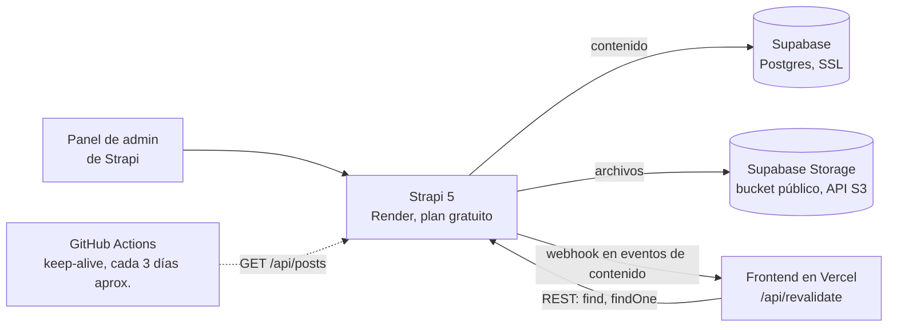

[English](README.md) · **Español**

# Cuaderno · Backend

El CMS headless detrás de [Cuaderno](https://mini-blog-frontend-rouge.vercel.app): una API de Strapi 5 en el plan gratuito de Render. Usa Postgres y almacenamiento de archivos en Supabase, un webhook que avisa al frontend cuando cambia el contenido y un keep-alive con GitHub Actions que evita que Supabase pause el proyecto por inactividad.

[**Sitio en vivo**](https://mini-blog-frontend-rouge.vercel.app) · [Repositorio del frontend](https://github.com/tatianadelsoglio/mini-blog-frontend) · [](https://github.com/tatianadelsoglio/mini-blog-backend/actions/workflows/ci.yml)



Este repositorio es solo la API de contenido. La experiencia de lectura, la estrategia de caché y el diseño están en el [repositorio del frontend](https://github.com/tatianadelsoglio/mini-blog-frontend).

## Tipos de contenido

| Tipo | Clase | Campos |
| --- | --- | --- |
| **Post** | Collection, con borrador y publicación | `title` (obligatorio), `slug` (UID a partir del título, obligatorio), `excerpt` (texto, hasta 300 caracteres), `content` (texto enriquecido, guardado como Markdown), `coverImage` (una imagen), `category` (muchos posts a una categoría) |
| **Category** | Collection, sin borrador y publicación | `name` (obligatorio, único), `slug` (UID a partir del nombre, obligatorio), `description` (texto), `posts` (la relación inversa) |
| **About** | Single type, con borrador y publicación | `title` (obligatorio), `content` (texto enriquecido), `photo` (una imagen), `githubUrl`, `linkedinUrl` (deben cumplir `^https?://.+`) |

Los controllers, routes y services son las factories core de Strapi: no hay lógica de negocio propia. La API REST está configurada con `strictParams` (se rechazan los parámetros de query desconocidos), un tamaño de página por defecto de 25 y un máximo de 100. Las subidas se limitan a imágenes, video, audio, PDF, archivos de Office y texto plano/CSV, y se deniegan los tipos ejecutables más comunes.

## Infraestructura

- **Blueprint de Render ([`render.yaml`](render.yaml)).** Un web service gratuito con Node 22 (de [`.nvmrc`](.nvmrc)), health check en `/_health` y auto-deploy. Los secretos de Strapi los genera Render; el resto de lo sensible se carga en el dashboard (`sync: false`). El build instala las dependencias de desarrollo (Strapi necesita TypeScript para compilar) y fija `NODE_OPTIONS=--max-old-space-size=1536` solo en el build, para no limitar el runtime. El build del admin necesita más de 1 GB de heap; corre en el pipeline de build de Render, no en los 512 MB del runtime gratuito.
- **Postgres en Supabase, con SSL.** Conexión por el pooler de Supabase con un pool chico (de 0 a 5 conexiones, definido en `render.yaml`). La validación del certificado está activa (`DATABASE_SSL_REJECT_UNAUTHORIZED=true`): el CA de Supabase se lee de `DATABASE_SSL_CA` (contenido PEM, en Render) o del archivo de `DATABASE_SSL_CA_FILE` (local). El `.crt` está en `.gitignore`.
- **Archivos en Supabase Storage, con el provider S3.** En producción el plugin de upload usa siempre `@strapi/provider-upload-aws-s3` apuntando al endpoint S3 de Supabase con direccionamiento path-style, y las URLs de los archivos salen de la URL pública del bucket. Supabase Storage no tiene ACLs, así que el parámetro ACL se desactiva explícitamente. En desarrollo se usan subidas locales salvo que se defina `UPLOAD_PROVIDER=s3`. La app falla al arrancar con un mensaje claro si falta alguna variable de S3. El disco del plan gratuito de Render se borra en cada reinicio, por eso en producción no se guardan archivos localmente.
- **Permisos públicos fijados en el bootstrap ([`src/index.ts`](src/index.ts)).** En cada arranque se deja al rol Public en solo lectura: `find` y `findOne` en Post y Category, `find` en About, y se quita cualquier otro permiso del rol sobre esos tres tipos (create, update, delete). El paso es idempotente. Para cambiar estos permisos se modifica el código, no el admin. Los permisos sobre otros tipos y los de otros roles no se tocan.
- **Content Security Policy ([`config/middlewares.ts`](config/middlewares.ts)).** `img-src` y `media-src` incluyen el origen de Supabase para que la biblioteca de medios del admin pueda mostrar las imágenes subidas.

## Webhook hacia el frontend

Strapi guarda los webhooks en la base de datos, así que este se crea una vez por base en **Settings → Webhooks**:

- **URL:** `https://<frontend>/api/revalidate`
- **Header:** `x-revalidate-secret`, con el mismo valor que el `REVALIDATE_SECRET` del frontend (el valor nunca se commitea).
- **Eventos (Entry):** `create`, `update`, `delete`, `publish` y `unpublish`, para todos los content types. El frontend recibe el modelo (`post`, `category` o `about`) en el payload y expira los tags de caché que corresponden. Category no tiene borrador y publicación, así que solo dispara create, update y delete.

## Keep-alive y CI

**Keep-alive** ([`.github/workflows/keep-alive.yml`](.github/workflows/keep-alive.yml)): cada 3 días aproximadamente (se programa por día del mes, así que el intervalo real es de 1 a 3 días; también puede correr a pedido desde la pestaña Actions) consulta `/api/posts?pagination[pageSize]=1`. Eso despierta a Render durante ese pedido (se vuelve a dormir a los 15 minutos) y, sobre todo, hace una consulta real a Supabase, y el plan gratuito de Supabase pausa los proyectos inactivos tras alrededor de una semana. Usa un timeout largo por el arranque en frío y reintenta hasta 5 veces, con 30 segundos de espera, ante cualquier falla. La URL del backend está en el secret de repositorio `STRAPI_URL`. GitHub desactiva los workflows programados si el repositorio pasa 60 días sin actividad, así que hay que reactivarlo desde la pestaña Actions si eso pasa.

**CI** ([`.github/workflows/ci.yml`](.github/workflows/ci.yml)): en cada push y pull request a `main` instala las dependencias, corre el typecheck y el build de producción (`strapi build`, que compila el panel de admin). El build usa variables de entorno de relleno y no se conecta a la base ni a Supabase.

## Despliegue paso a paso

La guía completa, con los valores exactos, está en [`docs/deploy.md`](docs/deploy.md). En resumen:

1. **Supabase:** crear un bucket público llamado `uploads`, generar las access keys de S3 y anotar el endpoint, la región y la URL pública del bucket.
2. **Render:** crear un Blueprint desde este repositorio para que lea `render.yaml` y completar las variables marcadas `sync: false`.
3. **Certificado de la base:** descargar el CA de Supabase y pegar el PEM completo en `DATABASE_SSL_CA`.
4. **Primer deploy:** cargar `PUBLIC_URL` con la URL del servicio. Si esa URL recién se conoce al crear el servicio, desplegar una vez, cargarla y volver a desplegar limpiando la caché de build para que el admin se reconstruya con ella.
5. **Admin:** crear el primer administrador y después crear y publicar la página About (hasta entonces `/api/about` responde 404).
6. **Webhook:** crearlo como se describe arriba.
7. **Keep-alive:** agregar el secret de repositorio `STRAPI_URL` y correr el workflow una vez a mano para comprobar que da `HTTP 200`.

## Correrlo localmente

**Requisitos:** Node.js 22 (ver [`.nvmrc`](.nvmrc); `engines` permite `>=22 <23`).

```bash
npm ci
cp .env.example .env   # y editá los valores
npm run develop        # API y admin en http://localhost:1337
```

Si `DATABASE_CLIENT` no está definida, la base es un archivo SQLite local; ponela en `postgres` (como en `.env.example`) para usar Supabase.

| Script | Qué hace |
| --- | --- |
| `npm run develop` (o `dev`) | Strapi con auto-reload |
| `npm run build` / `npm start` | Compila el panel de admin / arranca en modo producción |
| `npm run typecheck` | `tsc --noEmit` |

## Variables de entorno

Referencia comentada en [`.env.example`](.env.example); los valores de ese archivo son de ejemplo.

| Variable | Para qué sirve |
| --- | --- |
| `HOST`, `PORT` | Dirección donde escucha Strapi (`0.0.0.0:1337`). Render define `PORT` por su cuenta. |
| `PUBLIC_URL` | URL pública del backend. Vacía en local; en Render, `https://<servicio>.onrender.com`. El build del admin la incorpora. |
| `IS_PROXIED` | `true` detrás de un proxy (Render), `false` en local. |
| `APP_KEYS`, `API_TOKEN_SALT`, `ADMIN_JWT_SECRET`, `TRANSFER_TOKEN_SALT`, `JWT_SECRET`, `ENCRYPTION_KEY` | Secretos de Strapi. Generá los tuyos; Render los genera por vos. Cambiar `API_TOKEN_SALT` invalida los API tokens existentes. |
| `DATABASE_CLIENT` | `postgres`, `mysql` o `sqlite` (por defecto `sqlite`). |
| `DATABASE_HOST`, `DATABASE_PORT`, `DATABASE_NAME`, `DATABASE_USERNAME`, `DATABASE_PASSWORD` | Conexión al pooler de Postgres. |
| `DATABASE_SSL`, `DATABASE_SSL_REJECT_UNAUTHORIZED` | Activan SSL y la validación del certificado (ambas en `true` contra Supabase). |
| `DATABASE_SSL_CA` / `DATABASE_SSL_CA_FILE` | El certificado CA: su contenido PEM (Render) o la ruta a un archivo (local). |
| `DATABASE_POOL_MIN`, `DATABASE_POOL_MAX` | Tamaño del pool de conexiones; chico por el plan gratuito de Supabase. |
| `UPLOAD_PROVIDER` | Con `s3` usa Supabase Storage en desarrollo; en producción siempre se usa S3. |
| `SUPABASE_S3_ENDPOINT`, `SUPABASE_S3_REGION`, `SUPABASE_S3_ACCESS_KEY_ID`, `SUPABASE_S3_SECRET_ACCESS_KEY`, `SUPABASE_S3_BUCKET` | Conexión compatible con S3 de Supabase Storage. |
| `SUPABASE_PUBLIC_URL` | URL pública del bucket, con su nombre. Se usa para las URLs de los archivos y la CSP. |

## Limitaciones

- **Plan gratuito de Render:** el servicio se duerme tras 15 minutos sin tráfico y tarda alrededor de un minuto en despertar; tiene 512 MB de RAM y disco efímero. El frontend está pensado para que los lectores casi nunca esperen por esto, pero yo sí espero cuando abro el admin después de un rato sin uso.
- **Memoria del build:** el build del admin necesita más heap del que tiene el runtime. Funciona porque Render buildea fuera de la instancia del runtime; un plan alternativo (buildear en GitHub Actions y desplegar el resultado) está descrito en [`docs/deploy.md`](docs/deploy.md) pero no está implementado.
- **Configuración manual por base:** el webhook se guarda en la base de datos, así que una base nueva requiere crearlo de nuevo.
- **Workflow programado:** el keep-alive se detiene tras 60 días sin actividad en el repositorio hasta que se lo reactiva.
- **Sin tests automatizados acá:** este repositorio verifica el typecheck y el build de producción en CI; la lógica testeada está en el frontend.
- **CORS** usa los valores por defecto de Strapi; el frontend solo consulta la API desde el servidor.

## Autora

Diseño y desarrollo: **Tatiana Delsoglio**, desarrolladora fullstack · TAMADE
[GitHub](https://github.com/tatianadelsoglio) · [LinkedIn](https://www.linkedin.com/in/tatiana-delsoglio/)
