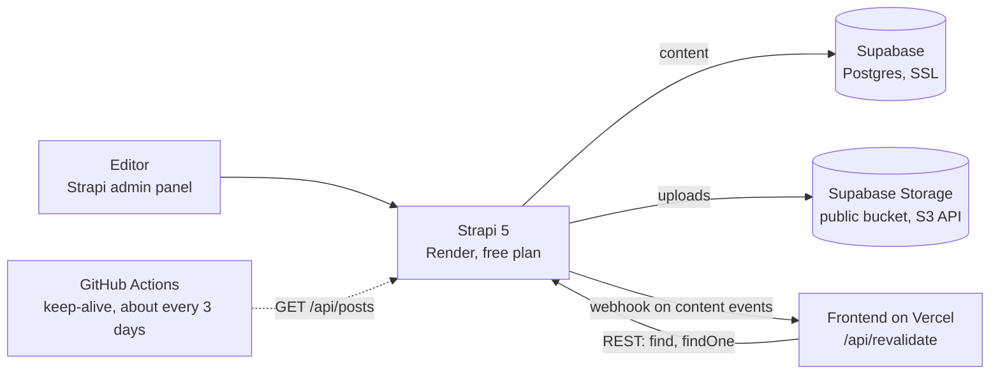

**English** · [Español](README.es.md)

# Cuaderno · Backend

The headless CMS behind [Cuaderno](https://mini-blog-frontend-rouge.vercel.app): a Strapi 5 API on Render's free plan. It uses Postgres and file storage on Supabase, a webhook that tells the frontend when content changes, and a GitHub Actions keep-alive so nothing stays asleep for long.

[**Live site**](https://mini-blog-frontend-rouge.vercel.app) · [Frontend repository](https://github.com/tatianadelsoglio/mini-blog-frontend) · [](https://github.com/tatianadelsoglio/mini-blog-backend/actions/workflows/ci.yml)



This repository is the content API only. The reading experience, the cache strategy and the design live in the [frontend repository](https://github.com/tatianadelsoglio/mini-blog-frontend).

## Content types

| Type | Kind | Fields |
| --- | --- | --- |
| **Post** | Collection, draft & publish | `title` (required), `slug` (UID from the title, required), `excerpt` (text, up to 300 characters), `content` (rich text, stored as Markdown), `coverImage` (single image), `category` (many posts to one category) |
| **Category** | Collection, no draft & publish | `name` (required, unique), `slug` (UID from the name, required), `description` (text), `posts` (the inverse relation) |
| **About** | Single type, draft & publish | `title` (required), `content` (rich text), `photo` (single image), `githubUrl`, `linkedinUrl` (must match `^https?://.+`) |

Controllers, routes and services are Strapi's core factories: there is no custom business logic. The REST API is configured with `strictParams` (unknown query parameters are rejected), a default page size of 25 and a maximum of 100. Uploads are limited to images, video, audio, PDF, Office and plain-text/CSV files, and common executable types are denied.

## Infrastructure

- **Render Blueprint ([`render.yaml`](render.yaml)).** One free web service on Node 22 (from [`.nvmrc`](.nvmrc)) with a `/_health` health check and auto-deploy. Render generates Strapi's secrets; other sensitive values are entered in the dashboard (`sync: false`). The build command installs dev dependencies (Strapi needs TypeScript to compile) and sets `NODE_OPTIONS=--max-old-space-size=1536` only for the build, so the runtime is not capped. The admin build needs more than 1 GB of heap; it runs in Render's build pipeline, not in the 512 MB of the free runtime.
- **Postgres on Supabase, with SSL.** Connection through Supabase's pooler with a small pool (0 to 5 connections, set in `render.yaml`). Certificate validation is on (`DATABASE_SSL_REJECT_UNAUTHORIZED=true`): the Supabase CA is read from `DATABASE_SSL_CA` (PEM contents, used on Render) or from the file in `DATABASE_SSL_CA_FILE` (local). The `.crt` is git-ignored.
- **File storage on Supabase Storage, through the S3 provider.** In production the upload plugin always uses `@strapi/provider-upload-aws-s3` pointed at Supabase's S3 endpoint with path-style addressing, and file URLs come from the bucket's public URL. Supabase Storage has no ACLs, so the ACL parameter is explicitly unset. In development, local uploads are used unless `UPLOAD_PROVIDER=s3`. The app fails at startup with a clear message if any S3 variable is missing. The disk on Render's free plan is wiped on restart, which is why uploads are not stored locally in production.
- **Public permissions set at bootstrap ([`src/index.ts`](src/index.ts)).** On every start the Public role is reset to read-only: `find` and `findOne` on Post and Category, `find` on About, and any other permission the role has on those three types (create, update, delete) is removed. The step is idempotent. To change these permissions you change the code, not the admin. Permissions on other types and other roles are not touched.
- **Content Security Policy ([`config/middlewares.ts`](config/middlewares.ts)).** `img-src` and `media-src` include the Supabase origin so the admin's media library can show the uploaded images.

## Webhook to the frontend

Strapi stores webhooks in the database, so this one is created once per database in **Settings → Webhooks**:

- **URL:** `https://<frontend>/api/revalidate`
- **Header:** `x-revalidate-secret`, set to the same value as the frontend's `REVALIDATE_SECRET` (the value is never committed).
- **Events (Entry):** `create`, `update`, `delete`, `publish` and `unpublish`, for all content types. The frontend receives the model (`post`, `category` or `about`) in the payload and expires the matching cache tags. Category has no draft & publish, so it only fires create, update and delete.

## Keep-alive and CI

**Keep-alive** ([`.github/workflows/keep-alive.yml`](.github/workflows/keep-alive.yml)): about every 3 days (it is scheduled by day of the month, so the gap is 1 to 3 days; it can also run on demand from the Actions tab) it requests `/api/posts?pagination[pageSize]=1`. That wakes Render and runs a real query against Supabase, and Supabase's free plan pauses inactive projects after about a week. It uses a long timeout for the cold start and retries up to 5 times, 30 seconds apart, on any failure. The backend URL lives in the `STRAPI_URL` repository secret. GitHub disables scheduled workflows after 60 days without repository activity, so it has to be re-enabled from the Actions tab if that happens.

**CI** ([`.github/workflows/ci.yml`](.github/workflows/ci.yml)): on every push and pull request to `main`, it installs dependencies, runs the type check and runs the production build (`strapi build`, which compiles the admin panel). The build uses placeholder environment variables and does not connect to the database or to Supabase.

## Deploy, step by step

The full guide, with the exact values, is in [`docs/deploy.md`](docs/deploy.md). In short:

1. **Supabase:** create a public bucket named `uploads`, generate S3 access keys, and note the endpoint, region and the bucket's public URL.
2. **Render:** create a Blueprint from this repository so it reads `render.yaml`, then fill in the variables marked `sync: false`.
3. **Database certificate:** download the Supabase CA and paste its full PEM into `DATABASE_SSL_CA`.
4. **First deploy:** set `PUBLIC_URL` to the service URL If the URL is only known after the service is created, deploy once, set it, then redeploy with a cleared build cache so the admin is rebuilt with it.
5. **Admin:** create the first administrator, then create and publish the About page (until then `/api/about` answers 404).
6. **Webhook:** create it as described above.
7. **Keep-alive:** add the `STRAPI_URL` repository secret and run the workflow once by hand to check for `HTTP 200`.

## Run it locally

**Requirements:** Node.js 22 (see [`.nvmrc`](.nvmrc); `engines` allows `>=22 <23`).

```bash
npm ci
cp .env.example .env   # then edit the values
npm run develop        # API and admin at http://localhost:1337
```

If `DATABASE_CLIENT` is not set, the database defaults to a local SQLite file; set it to `postgres` (as in `.env.example`) to use Supabase.

| Script | What it does |
| --- | --- |
| `npm run develop` (or `dev`) | Strapi with auto-reload |
| `npm run build` / `npm start` | Build the admin panel / start in production mode |
| `npm run typecheck` | `tsc --noEmit` |

## Environment variables

Annotated reference in [`.env.example`](.env.example); the values there are placeholders.

| Variable | What it is for |
| --- | --- |
| `HOST`, `PORT` | Address Strapi listens on (`0.0.0.0:1337`). Render sets `PORT` itself. |
| `PUBLIC_URL` | Public URL of the backend. Empty locally; on Render, `https://<service>.onrender.com`. The admin build embeds it. |
| `IS_PROXIED` | `true` behind a proxy (Render), `false` locally. |
| `APP_KEYS`, `API_TOKEN_SALT`, `ADMIN_JWT_SECRET`, `TRANSFER_TOKEN_SALT`, `JWT_SECRET`, `ENCRYPTION_KEY` | Strapi's secrets. Generate your own; Render generates them for you. Changing `API_TOKEN_SALT` invalidates existing API tokens. |
| `DATABASE_CLIENT` | `postgres`, `mysql` or `sqlite` (default `sqlite`). |
| `DATABASE_HOST`, `DATABASE_PORT`, `DATABASE_NAME`, `DATABASE_USERNAME`, `DATABASE_PASSWORD` | Connection to the Postgres pooler. |
| `DATABASE_SSL`, `DATABASE_SSL_REJECT_UNAUTHORIZED` | Turn SSL and certificate validation on (both `true` against Supabase). |
| `DATABASE_SSL_CA` / `DATABASE_SSL_CA_FILE` | The CA certificate: its PEM contents (Render) or a file path (local). |
| `DATABASE_POOL_MIN`, `DATABASE_POOL_MAX` | Connection pool size; kept small for the free Supabase plan. |
| `UPLOAD_PROVIDER` | Set to `s3` to use Supabase Storage in development; in production S3 is always used. |
| `SUPABASE_S3_ENDPOINT`, `SUPABASE_S3_REGION`, `SUPABASE_S3_ACCESS_KEY_ID`, `SUPABASE_S3_SECRET_ACCESS_KEY`, `SUPABASE_S3_BUCKET` | Supabase Storage's S3-compatible connection. |
| `SUPABASE_PUBLIC_URL` | Public URL of the bucket, including its name. Used for file URLs and the CSP. |

## Limitations

- **Render's free plan:** the service sleeps after 15 minutes without traffic and takes about a minute to wake up; it has 512 MB of RAM and an ephemeral disk. The frontend is built so readers never wait for this, but I do when I open the admin after a quiet period.
- **Build memory:** the admin build needs a larger heap than the runtime has. It works because Render builds outside the runtime instance; a fallback plan (build in GitHub Actions and deploy the output) is described in [`docs/deploy.md`](docs/deploy.md) but is not implemented.
- **Manual setup per database:** the webhook is stored in the database, so a new database needs it created again.
- **Scheduled workflow:** the keep-alive stops after 60 days without repository activity until it is re-enabled.
- **No automated tests here:** this repository checks the type check and the production build in CI; the tested logic lives in the frontend.
- **CORS** uses Strapi's defaults; the frontend only calls the API from the server.

## Author

Designed and developed by **Tatiana Delsoglio** · TAMADE, fullstack developer.
[GitHub](https://github.com/tatianadelsoglio) · [LinkedIn](https://www.linkedin.com/in/tatiana-delsoglio/)
